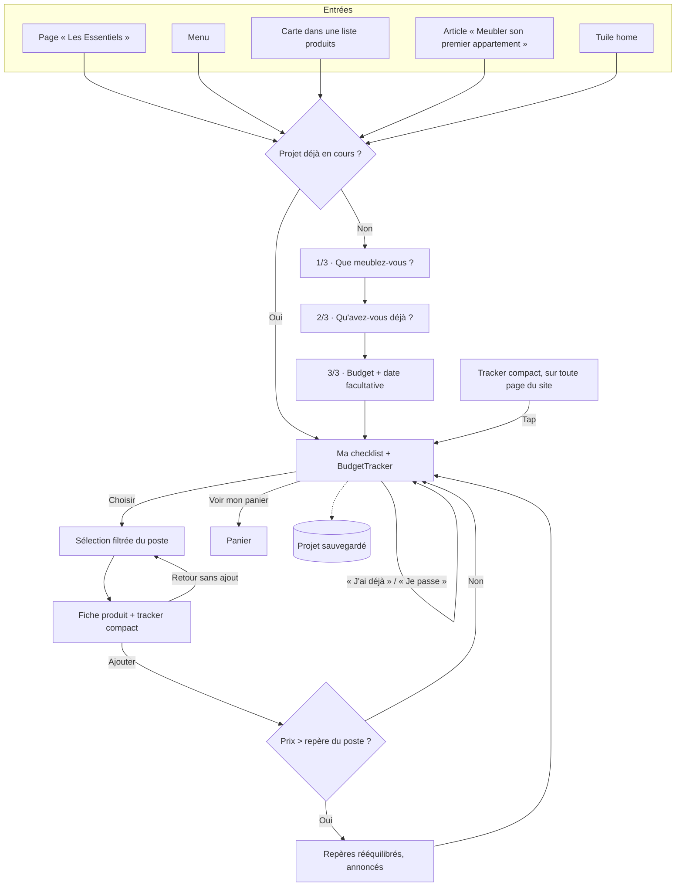

# Vente-unique — Phases 3 et 4 : Développer, Livrer

Nov 21, 2026 · @Kao

## Phase 3 — Pistes explorées et grille de décision

Je retiens « Mon projet d'aménagement » (piste A) : un parcours guidé par le budget, ouvert à tous, mais pensé d'abord pour le primo-accédant. C'est la seule piste qui répond à la fois aux HMW 1, 2 et 3, avec des composants proches de ceux qui existent déjà. J'y intègre le meilleur des packs (piste B), sous forme de sélections recommandées.

Chaque critère est noté de 1 (faible) à 3 (fort). Pour la faisabilité, 3 signifie « facile à livrer ».

| Piste | Principe | Impact utilisateur | Impact business | Faisabilité | Cohérence avec le design system | Total |
| --- | --- | --- | --- | --- | --- | --- |
| **A. Parcours guidé « Mon projet d'aménagement »** | 3 questions (quoi, déjà possédé, budget) → checklist priorisée avec budget repère par poste → sélections filtrées → jauge de budget toujours visible | 3 | 3 | 2 | 3 | **11** |
| B. Packs « studio » prêts à acheter | Des lots complets à prix global | 2 | 3 | 2 | 3 | 10 |
| E. Liste partagée avec les proches | Les parents financent un article de la liste | 2 | 2 | 2 | 3 | 9 |
| D. Quiz de style | Quelques questions → une sélection à son goût | 1 | 2 | 3 | 3 | 9 |
| C. Visualisation 3D ou AR du studio | Placer les meubles dans son logement | 2 | 2 | 1 | 1 | 6 |

**Pourquoi pas les autres**

- **B** : un pack enlève le choix et suppose de gérer le stock de combinaisons fixes. Je garde son idée sous forme de sélection recommandée et modifiable dans la piste A.
- **D** : le style n'est pas le blocage d'un primo-accédant. Le site couvre déjà les styles.
- **C** : répond au HMW 4 (roadmap), avec un coût de développement et de contenu élevé.
- **E** : repose sur H6, l'hypothèse la moins étayée. Elle va dans la roadmap.

## Phase 3 — Concept retenu : « Mon projet d'aménagement »

**En une phrase** : un seul outil, accessible à tous, qui transforme « je ne sais pas quoi acheter » en une liste priorisée avec un budget suivi en temps réel.

**Donner un parcours à une intention qui existe déjà.** Vente-unique a créé la gamme « Les Essentiels — Tout pour bien commencer » (410 produits) pour ceux qui aménagent leur premier chez-soi « sans dépasser leur budget ». Mais c'est une liste produits à plat, sans ordre ni suivi du budget. « Mon projet d'aménagement » transforme cette promesse en parcours.

**Pensé pour Léa, utile à tous.** Le brief porte sur le jeune qui se meuble pour la première fois : c'est le cas principal, celui qui guide chaque arbitrage et chaque écran. Mais son besoin (savoir quoi acheter, dans quel ordre, pour combien) est le même pour quelqu'un qui refait une chambre ou s'installe à deux. Seul le point de départ change. Un outil générique évite de demander à l'utilisateur de se ranger dans une case, et il est développé une seule fois.

### Les 4 briques

1. **Trois questions au démarrage (30 secondes)**
   - *Que meublez-vous ?* Tout un logement (studio, T1, T2, colocation) ou une pièce (chambre, salon, cuisine).
   - *Qu'avez-vous déjà ?* L'utilisateur coche ce qu'il possède, ces postes sortent de la liste.
   - *Quel est votre budget ?* Avec un repère par type de logement. La date d'emménagement est facultative ; si elle est renseignée, elle filtre la livraison.
2. **Une checklist générée et priorisée**
   - Trois niveaux : *dès le premier soir* (lit et matelas, rangement des vêtements, table et chaises), *dans le premier mois* (canapé ou canapé-lit, meuble TV, bureau), *pour se sentir chez soi* (luminaires, tapis, décoration).
   - Chaque poste a un **budget repère**, modifiable.
   - Chaque poste a quatre états : à choisir, choisi, « j'ai déjà », « je passe ».
   - **Rééquilibrage** : si un produit choisi dépasse le repère de son poste, l'écart est retiré proportionnellement des repères des postes encore à choisir. Le changement est annoncé (« Repères ajustés : -49 € répartis sur 6 postes »), jamais silencieux. Le budget total, lui, ne change que si l'utilisateur le modifie.
3. **Une sélection filtrée par poste**
   - La liste produits existante, avec des filtres pré-appliqués et visibles : prix inférieur ou égal au repère du poste, livraison avant la date (si elle est renseignée), dimensions adaptées au logement.
   - La gamme « Les Essentiels » alimente la sélection en priorité : elle existe, et elle vise déjà le premier logement. L'outil la range par poste, ce qu'elle ne fait pas aujourd'hui.
   - Les compléments arrivent au bon moment, avec le panneau « Produits complémentaires » qui existe déjà : un matelas compatible après le choix du lit.
   - Quand une date est renseignée, chaque produit choisi affiche « ✓ Livré avant le 12 déc. ». Le site exprime aujourd'hui les délais en durée (« sous 5 à 6 semaines ») : la date est calculée à partir de ce délai. En MVP, le filtre de disponibilité existant (sous 2 ou 4 semaines) suffit ; la date exacte est une évolution.
4. **Le `BudgetTracker`, présent tout au long du parcours**
   - Montant des produits sur le budget, **livraison estimée indiquée en plus**, et progression des essentiels (« 3 sur 8 réglés »). Le panier estime la livraison à « à partir de 113,99 € » pour un lit à 699,99 € : la taire fausserait le budget, mais l'ajouter au total mélangerait un prix sûr et une estimation.
   - Distance jusqu'au prochain seuil promo (type -11 % dès 500 €), seulement s'il reste atteignable dans le budget.
   - Mensualité en paiement fractionné, avec la mention légale.
   - Alerte en cas de dépassement.
   - En version compacte et fixée en bas, il sert aussi de bouton pour revenir à l'outil depuis n'importe quelle page.

**Ajout au panier** : choisir un produit l'ajoute au panier et règle le poste en une seule action. Il n'y a pas de « panier du projet » séparé. La jauge compte les articles du projet ; la distance au seuil promo se calcule sur tout le panier éligible (hors marketplace), comme le fait le site.

**Sauvegarde** : aucun compte n'est demandé pour commencer. Le projet est gardé sur l'appareil ; au premier ajout, on propose de le sauvegarder sur son compte pour le retrouver sur un autre appareil et recevoir les relances (V2).

### Les points d'entrée

| Emplacement | Forme | Pourquoi |
| --- | --- | --- |
| Page « Les Essentiels » | Un bouton « Je crée mon projet » dans le bandeau éditorial de la gamme | Le public visé y est déjà ; c'est l'entrée la plus naturelle |
| Menu | Une seule entrée transversale, à la suite de « Nouveautés » et « Inspirations & conseils » | Le besoin est le même pour tous les projets : une seule entrée suffit |
| Listes produits | Une carte insérée dans la grille, après la 2e rangée : « Vous équipez tout un logement ? » | Capte l'utilisateur au moment où il navigue catégorie par catégorie (étape 3 de la journey map) |
| Inspirations & conseils | Article « Meubler son premier appartement », qui mène à l'outil | SEO : être trouvé sur la recherche de l'étape 2 (« lister ses besoins ») |
| Home | Une tuile dans « Bienvenue dans nos rayons », pas une bannière | Visible sans prendre la place des promos |
| Partout, projet en cours | Le `BudgetTracker` compact fixé en bas | Point de retour permanent |
| V2 | Entrée contextuelle selon le comportement (plusieurs catégories consultées dans la session) | Montrer l'outil à ceux qui en ont besoin, au bon moment |

### Ce que chaque partie y gagne

| | Pour l'utilisateur | Pour Vente-unique |
| --- | --- | --- |
| Checklist priorisée | Sait quoi acheter et dans quel ordre (H1) | Capte la visite avant les concurrents ; plus de catégories par commande |
| Budget repère par poste | Ne dépasse pas son budget (H2) | Moins d'abandons liés au prix, plus de confiance |
| Seuil promo dans la jauge | Débloque une remise sans sortir de son budget | Panier moyen qui monte vers le seuil, quand il est atteignable |
| Paiement fractionné affiché | Voit ce que ça représente par mois | Lève le frein du montant total sur un budget tendu |
| Filtre « livré avant le… » | Installé à temps (H3) | Moins d'abandons et moins d'appels au service client |
| Un seul outil générique | Personne n'a à se ranger dans une case | Développé une fois, réutilisé pour tous les projets |
| Tracker compact persistant | Retrouve son projet sans le chercher | Plus de retours sur le parcours, projet sauvegardé et relançable |

### Garde-fous

- Le seuil promo n'apparaît que s'il est inférieur ou égal au budget. La jauge aide à tenir le budget, elle ne pousse pas à le dépasser.
- Le seuil se calcule sur le montant éligible (hors marketplace) : la jauge n'annonce jamais une remise que le panier n'obtiendra pas.
- Le total et la jauge ne comptent que les produits. La livraison, estimée, est écrite juste en dessous comme un montant à ajouter (« + 63 € de livraison estimée, non incluse ») : l'utilisateur sait que le panier coûtera un peu plus, sans qu'une estimation se mêle à un prix sûr.
- La mensualité est toujours accompagnée de la mention « Un crédit vous engage et doit être remboursé ».
- Le rééquilibrage des repères est toujours annoncé.

### Ce que j'ai écarté, et pourquoi

- **Une bannière sur la home réservée aux primo-accédants** : on ignore le poids de ce segment, et la home appartient aux promos.
- **Une entrée par projet dans le menu** (« Premier logement », « Refaire ma chambre »…) : le besoin est le même pour tous, seul le point de départ change. La question 1 s'en charge.
- **L'AR, un quiz de style, des packs** : soit plus coûteux à développer, soit hors de l'insight. Le problème est de savoir quoi acheter, pas de choisir un style.

### Hypothèses à annoncer

- Les budgets repères sont à construire avec les données de prix et de paniers de Vente-unique. Le chiffre public de 1 200 à 3 000 € couvre toute l'installation (dépôt de garantie, assurance…), pas seulement les meubles : il ne peut pas servir de repère tel quel.
- Le poids du segment est à vérifier : part des nouveaux clients, part des commandes multi-catégories.
- La découvrabilité des entrées reste à tester : en test, l'utilisateur trouve-t-il l'outil seul ? Ensuite, un A/B test sur l'emplacement.

## Phase 3 — User flow



**Lecture** : l'utilisateur répond une seule fois aux trois questions, puis boucle entre la checklist, la sélection et la fiche produit jusqu'à ce que ses essentiels soient réglés. « J'ai déjà » et « Je passe » règlent un poste sans achat. S'il a déjà un projet, toute entrée le ramène directement à sa checklist. Le tracker compact le ramène au projet depuis n'importe quelle page.

**Décisions prises dans le flow**

- **Pas de compte pour commencer** : les trois questions viennent avant toute demande d'identification.
- **Une question par écran** : un pas clair sur mobile, avec une progression « 1/3 » qui reprend le stepper du panier (rail en pilule, étapes numérotées).
- **Des boutons d'appel à la première personne**, comme sur le site (« J'en profite », « Je découvre ») : « Je crée mon projet », « Je découvre ma liste ». Les boutons d'action restent simples (« Choisir », « Voir mon panier »).
- **Le panier reste le panier du site** : pas de tunnel parallèle à maintenir.

## Phase 3 — Wireframes basse fidélité (6 écrans mobiles)

Écrans en 375 px de large. Les crochets `[ ]` sont des boutons, les parenthèses `( )` des puces, `━` la partie remplie d'une jauge et `|` le repère du seuil promo.

### W1 · Point d'entrée dans une liste produits

```
┌────────────────────────────────────┐
│ ☰   vente-unique            ⌕   🛒 │
│ ‹ Lits                             │
│ 1 248 produits    Filtrer   Trier  │
├─────────────────┬──────────────────┤
│ [image]         │ [image]          │
│ Lit coffre 160  │ Lit 140 x 190    │
│ 299 €           │ 189 €            │
├─────────────────┴──────────────────┤
│ Vous équipez tout un logement ?    │
│ On vous dit quoi acheter en        │
│ premier, budget suivi en direct.   │
│ [ Je crée mon projet ]          ✕  │
├─────────────────┬──────────────────┤
│ [image]         │ [image]          │
```

La carte a le format d'une rangée de la grille et le style des cartes du site : elle se lit comme un service, pas comme une publicité. Elle apparaît une seule fois par liste et se ferme.

### W2 · Démarrage (3 questions)

```
┌────────────────────────────────────┐      ┌────────────────────────────────────┐
│ ✕                        Étape 1/3 │      │ ‹                        Étape 3/3 │
│ ━━━━━━━━━━━░░░░░░░░░░░░░░░░░░░░░░░ │      │ ━━━━━━━━━━━━━━━━━━━━━━━━━━━━━━━━━━ │
│                                    │      │                                    │
│ Que meublez-vous ?                 │      │ Quel est votre budget ?            │
│                                    │      │ [ 1 500 €                        ] │
│ Tout un logement                   │      │ Repère pour un studio : X à Y €    │
│ (Studio) (T1) (T2) (Colocation)    │      │                                    │
│                                    │      │ Date d'emménagement (facultatif)   │
│ Une pièce                          │      │ [ 12/12/2026                     ] │
│ (Chambre) (Salon) (Cuisine)        │      │ On vous montrera seulement ce qui  │
│                                    │      │ arrive avant cette date.           │
│                                    │      │                                    │
│ [           Continuer            ] │      │ [ Je découvre ma liste (8)       ] │
└────────────────────────────────────┘      └────────────────────────────────────┘
```

L'étape 2/3 (« Qu'avez-vous déjà ? ») présente les postes du logement choisi, groupés par pièce, tous décochés par défaut. Le repère de budget (X à Y €) reste à calculer avec les données de Vente-unique.

### W3 · Ma checklist (l'écran qui passe en haute fidélité)

```
┌────────────────────────────────────┐
│ ☰   vente-unique            ⌕   🛒 │
│ ‹ Retour                           │
│ Mon projet d'aménagement           │
│ (Studio) (Avant le 12 déc.)        │
│ (1 500 €)                 Modifier │
│                                    │
│ DÈS LE PREMIER SOIR                │
│ ┌────────────────────────────────┐ │
│ │ [img] Lit et matelas           │ │
│ │       Ensemble PRESTIGE 90x190 │ │
│ │       399,99 €                 │ │
│ │       ✓ Livré avant le 12 déc. │ │
│ │                        Retirer │ │
│ └────────────────────────────────┘ │
│ ┌────────────────────────────────┐ │
│ │ Rangement des vêtements        │ │
│ │ Repère : 200 €  ✎              │ │
│ │ [ Choisir ]        J'ai déjà   │ │
│ └────────────────────────────────┘ │
│ ┌────────────────────────────────┐ │
│ │ Table et chaises               │ │
│ │ Repère : 180 €  ✎              │ │
│ │ [ Choisir ]        J'ai déjà   │ │
│ └────────────────────────────────┘ │
│ DANS LE PREMIER MOIS        ⌄      │
├────────────────────────────────────┤
│ 400 € sur 1 500 €    1 sur 8 réglé │
│ + 63 € de livraison estimée,       │
│   non incluse                      │
│ ━━━━━━━━░░░░░░░░░░░|░░░░░░░░░░░░░░ │
│ Plus que 100 € pour -11%           │
│ ou 3 x 133,33 € avec Alma*         │
│ [        Voir mon panier         ] │
└────────────────────────────────────┘
```

Les deux autres niveaux sont repliés au départ pour garder l'écran court : on voit d'abord les essentiels. La mention légale du crédit (*) est en bas de page. Les montants sont illustratifs : le total et le seuil promo ne comptent que les produits, la livraison estimée est indiquée en plus (399,99 € + 100 € ≈ 500 €). Le produit choisi est réel : l'ensemble sommier coffre + matelas 90 x 190 cm PRESTIGE de la gamme « Les Essentiels », 399,99 € le 21 novembre 2026 ; la livraison estimée de 63 € est illustrative.

### W4 · Sélection filtrée d'un poste

```
┌────────────────────────────────────┐
│ ‹ Ma liste                         │
│ Rangement des vêtements            │
│ (≤ 200 € ✕) (Livré av. 12/12 ✕)    │
│ (Petit espace ✕)      + Filtres    │
│ 7 produits · Les Essentiels        │
├─────────────────┬──────────────────┤
│ [image]         │ [image]          │
│ Penderie 2 p.   │ Commode 4 tir.   │
│ 159 €           │ 189 €            │
│ Livré le 5 déc. │ Livré le 9 déc.  │
├─────────────────┴──────────────────┤
│ ...                                │
├────────────────────────────────────┤
│ Mon projet · 463 / 1 500 € · 1/8 › │
└────────────────────────────────────┘
```

C'est la liste produits existante. Les filtres pré-appliqués sont rappelés sous le titre et se retirent d'un tap.

### W5 · Fiche produit pendant un projet

```
┌────────────────────────────────────┐
│ [        galerie produit         ] │
│ PENDERIE OSLO                      │
│ 159 €  ·  ★ 4,4 (212)              │
│ Dimensions · Livraison · Avis      │
│ ...                                │
├────────────────────────────────────┤
│ Mon projet · 463 / 1 500 € · 1/8 › │
├────────────────────────────────────┤
│ (- 1 +) [ Ajouter au projet ]   ♡  │
│ Payez en 3x ou 4x                  │
└────────────────────────────────────┘
```

La barre d'achat du site reste en place. Le tracker se réduit à une ligne au-dessus. Le bouton devient « Ajouter au projet » : il ajoute au panier et règle le poste.

### W6 · Retour au projet depuis le reste du site

```
┌────────────────────────────────────┐
│ ☰   vente-unique            ⌕   🛒 │
│ (n'importe quelle page du site)    │
│ ...                                │
├────────────────────────────────────┤
│ Mon projet · 463 / 1 500 € · 1/8 › │
└────────────────────────────────────┘
```

Tant qu'un projet est en cours, le tracker compact est le chemin du retour. On peut le réduire en pastille.

## Phase 3 — Walkthrough des wireframes

Sans utilisateurs à tester, j'ai parcouru les wireframes avec la méthode du *cognitive walkthrough*, en me mettant à la place de Léa et en posant à chaque étape les quatre questions classiques (sait-elle quoi faire, voit-elle comment, comprend-elle la réponse, sait-elle qu'elle avance).

| Écran | Problème repéré | Correction apportée |
| --- | --- | --- |
| W1 | La carte insérée peut être prise pour une publicité et ignorée | Même format que les cartes produits, formulation de service, une seule fois par liste, refermable |
| W2 · étape 2 | Pour un logement entier, la liste « Qu'avez-vous déjà ? » est longue | Postes groupés par pièce, tous décochés par défaut |
| W2 · étape 3 | Saisir un budget sans repère est difficile, et le chiffre public (1 200 à 3 000 €) inclut le dépôt de garantie | Repère calculé sur les paniers Vente-unique (hypothèse annoncée) |
| W3 | Le crayon ✎ seul ne dit pas que le repère se modifie | Toute la ligne « Repère : 200 € » est cliquable et ouvre un champ |
| W3 | Après un achat plus cher que prévu, les repères changent sans explication | Message « Repères ajustés : -49 € répartis sur 6 postes » |
| W4 | Les filtres pré-appliqués peuvent faire croire que le choix est réduit | Filtres visibles et retirables, nombre de produits affiché |
| W5 | Deux barres fixées en bas peuvent se gêner | Le tracker passe en une ligne au-dessus de la barre d'achat existante |
| W6 | Un tracker toujours visible peut agacer | Réductible en pastille ; disparaît quand le projet est terminé |

À tester en priorité avec de vrais utilisateurs : W1 (trouve-t-on l'outil seul ?) et W3 (la jauge et le seuil sont-ils bien compris ?).

## Phase 4 — Design system reconstitué

Le relevé complet est dans [design-system/vente-unique-design-system.md](design-system/vente-unique-design-system.md), avec les tokens dans [tokens.json](design-system/tokens.json) et les captures. Il a été fait le 21 novembre 2026 sur les styles calculés de vente-unique.com (home, menu, liste produits, fiche produit, panier, gamme « Les Essentiels »), en mobile et en desktop. Je n'ai pas accès à leur Figma : les noms de tokens sont les miens, les valeurs sont celles du site.

### L'essentiel pour l'écran et le composant

| Élément | Valeur relevée |
| --- | --- |
| Texte fort, bouton principal | #130C0C |
| Texte courant / secondaire | rgba(23, 13, 14, 0.8) / rgba(31, 20, 21, 0.61) |
| Marque (liens, pastilles) | #EC002E — jamais en fond de bouton |
| Succès (« En stock ») | #008554 |
| Remise | texte #BD4800 sur #FFF1EB |
| Fond de page | #FFFFFF |
| Surface douce (champs, encarts) | rgba(197, 185, 187, 0.14) |
| Bordures | 1 px ; 2 px pour l'état sélectionné |
| Typographie | Poppins (interface) ; Recoleta (éditorial), remplacée par Fraunces dans la maquette |
| Rayons | 14 (champs), 20 (images, encarts), 28 (boutons, cartes), 999 (puces) |
| Élévation des barres fixées | 0 10px 20px rgba(0, 0, 0, 0.12) |

### Patterns existants que la solution réutilise

- **Stepper du panier** pour les 3 questions de démarrage.
- **Barre de total fixée du panier** pour la jauge de budget.
- **Pastille de remise** pour la distance au seuil promo.
- **Vert « En stock »** pour « seuil atteint » et « ✓ Livré avant le… ».
- **Panneau « Produits complémentaires »** pour les compléments.
- **Encart d'information** (fond doux, rayon 20) pour le budget repère.
- **Bandeau éditorial « Les Essentiels »** (beige #F3ECE2, Recoleta) pour l'identité du projet.

### Ce que j'ajoute (absent du site relevé)

Un seul ajout, à valider avec l'équipe design : `color.status.danger`, qui réutilise `color.brand` (#EC002E) pour « budget dépassé ». Il est toujours accompagné d'un libellé et d'une icône, pour ne pas confondre l'alerte avec l'accent de marque. Le site n'a pas de rouge d'erreur visible dans les pages relevées.

*Corrections par rapport au premier relevé* : le fond de page est blanc (#F4F4F4 était la couleur des placeholders de chargement) ; les bordures font 1 px et non 0,8 px ; le vert d'état #1E7B4A, inventé, est remplacé par le vert existant #008554.

**Contrainte d'intégration** : sur la fiche produit, la barre d'achat est déjà fixée en bas de l'écran. Dans le parcours, la jauge prend cette place ; sur la fiche produit, elle se réduit à une ligne au-dessus de la barre d'achat.

## Phase 4 — Écran haute fidélité : spécifications pour Figma

L'écran à livrer dans Figma est « Ma checklist » (wireframe W3), en mobile 375 × 812. Sa version codée et interactive est sur la [page de démo](https://claude.ai/artifact/KzhLFXQFNn2tEjZuVzP5TK) : elle sert de référence pixel pour le reconstruire dans Figma, avec les tokens de la section précédente. La démo date de la direction précédente : titre, progression « 1 sur 8 réglé » et budget repère par poste sont à y reporter.

&#91;image: Écran haute fidélité « Ma checklist », mobile 375 px : un essentiel choisi, jauge « Plus que 100 € pour -11% »\]

### Structure de l'écran (de haut en bas)

| Zone | Contenu | Réutilise |
| --- | --- | --- |
| Bandeau promo | Fond noir, texte blanc 12 px, centré | Bandeau existant du site |
| En-tête | Menu (avec libellé), logo, aide, compte, panier ; recherche pleine largeur | En-tête existant |
| Retour + titre | « ‹ Retour » 13 px ; titre « Mon projet d'aménagement » Recoleta 24/32 | Style de titre éditorial du site |
| Récap du projet | Puces « Studio », « Avant le 12 déc. », « 1 500 € » + lien « Modifier » | Puces existantes (fond `surface.subtle`, rayon 999) |
| Groupes | Titre 14/600, puis cartes de poste (espacement 8 px) ; niveaux 2 et 3 repliés | — |
| Barre fixée en bas | `BudgetTracker` (total des produits, livraison estimée indiquée en plus, progression « 1 sur 8 réglé ») + bouton « Voir mon panier » 48 px | Barre de total fixée du panier (`shadow.raised`) et bouton principal existants |

### Carte de poste : un composant, trois variantes

- **À choisir** : nom du besoin (14/500), « Repère : 200 € ✎ » (12, `text.muted`, ligne cliquable), bouton secondaire « Choisir » (36 px, contour 1 px `border.default`, rayon 28) et lien « J'ai déjà ».
- **Choisi** : vignette 56 px (rayon 6), nom du besoin (12, `text.muted`), produit (13), prix (14/600), « ✓ Livré avant le 12 déc. » en `status.success` (seulement si une date est renseignée), lien « Retirer » ; bordure `text.strong`.
- **J'ai déjà** : fond `surface.subtle`, mention « Vous l'avez déjà », lien « Annuler ».
- Commun : fond blanc, padding 12, rayon 20 (comme les encarts et la carte « Ajouter : Couette » du site), bordure 1 px `border.default`.

### Frames à livrer

1. Ma checklist, début (1 poste choisi, « Plus que 100 € pour -11% ») : **l'écran haute fidélité principal**.
2. Variantes de la barre fixée : seuil atteint et budget dépassé (en composants, pas en écrans complets).
3. Page de composant `BudgetTracker` : variantes Figma avec auto-layout, et des propriétés qui reprennent les états du code (vide, en cours, seuil atteint, dépassé ; complet ou compact).

### Conseils de construction dans Figma

- Créer d'abord les variables (couleurs, rayons, espacements) avec les noms de tokens du code, pour que la passation avec les développeurs soit directe.
- Construire la carte de poste et `BudgetTracker` en composants avec variantes, puis assembler l'écran.
- Utiliser de vraies photos produit de Vente-unique dans les vignettes pour la présentation (la démo utilise des aplats).

## Phase 4 — Composant BudgetTracker

Le composant est codé en Vue 3, testé (8 cas) et documenté. La [page de démo](https://claude.ai/artifact/KzhLFXQFNn2tEjZuVzP5TK) montre l'écran de référence interactif, tous les états du composant et son API. Le code source (`BudgetTracker.vue`, tokens, tests, README) est dans `BudgetTracker.zip`.

**À reporter dans le code pour la nouvelle direction** : les props `completed`, `total` et `shippingEstimate`, la version compacte cliquable (`href` ou évènement `open`), et le vert #008554 à la place de #1E7B4A.

**Rôle** : afficher en permanence le montant dépensé sur le budget, la progression des essentiels, la distance au seuil promo et la mensualité en paiement fractionné, alerter en cas de dépassement, et, en version compacte, ramener à l'outil.

| État | Condition | Rendu |
| --- | --- | --- |
| Vide | Aucun article ajouté | « Ajoutez un essentiel pour suivre votre budget. » |
| En cours | Dans le budget, seuil non atteint | « Plus que 100 € pour -11% » |
| Seuil atteint | Montant éligible ≥ seuil | ✓ « -11 % débloqués », en vert |
| Dépassé | Montant > budget | Jauge rouge, ⚠ « Budget dépassé de 101 € » |
| Garde-fou | Seuil supérieur au budget | Repère et message promo masqués |
| Compact | `size="compact"` | Une ligne cliquable : « Mon projet · 463 / 1 500 € · 1/8 › » |

**Props** : `budget`, `spent` (obligatoires), `shippingEstimate` (ajouté au total et affiché à part), `completed`, `total`, `promoThreshold`, `promoLabel`, `promoEligibleAmount` (montant hors marketplace), `installments`, `size` (`default` ou `compact`), `href`, `label`. Évènement : `open`.

**Choix justifiés**

- **`role="meter"`** plutôt que `progressbar` : la jauge mesure une valeur dans une plage connue, ce n'est pas l'avancement d'une tâche.
- **`completed` et `total`** plutôt qu'une liste d'articles : le composant affiche un compte, il n'a pas à connaître la checklist. Il reste réutilisable hors du parcours.
- **Compact = lien qui contient la jauge** : une jauge ne peut pas être un bouton. La version compacte est un `<a>` (ou `<button>`) dont le nom accessible résume l'état : « Voir mon projet : 463 € sur 1 500 €, 1 essentiel sur 8 réglé ». La jauge à l'intérieur est décorative (`aria-hidden`).
- **`promoEligibleAmount`** : la promo ne vaut que pour les produits Vente-unique. Sans cette prop, la jauge annoncerait une réduction que le panier n'obtiendra pas.
- **Garde-fou** : la promo n'est mise en avant que si elle reste dans le budget. Le composant aide à tenir le budget, il ne pousse pas à le dépasser.
- **Couleurs** : noir #130C0C comme le bouton principal du site, rouge de marque pour l'alerte, toujours doublé d'une icône et d'un texte.
- **Valeurs de repli** : chaque token a une valeur par défaut, donc le composant s'affiche correctement même hors du design system.

**À valider avec l'équipe** : l'usage du rouge de marque pour « budget dépassé » ; la mention légale du crédit doit figurer dans la page qui affiche la mensualité.
